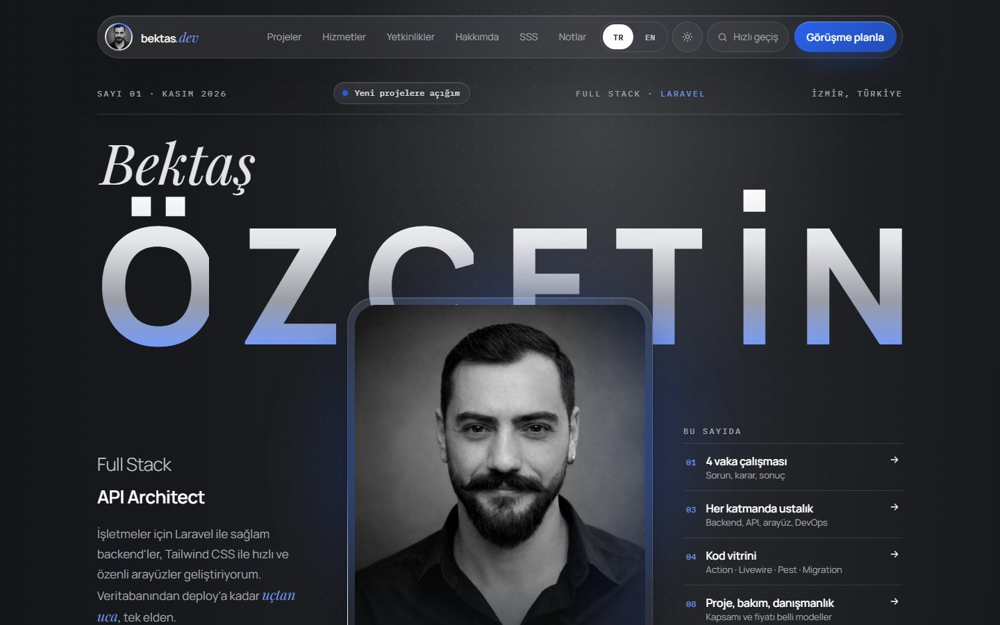
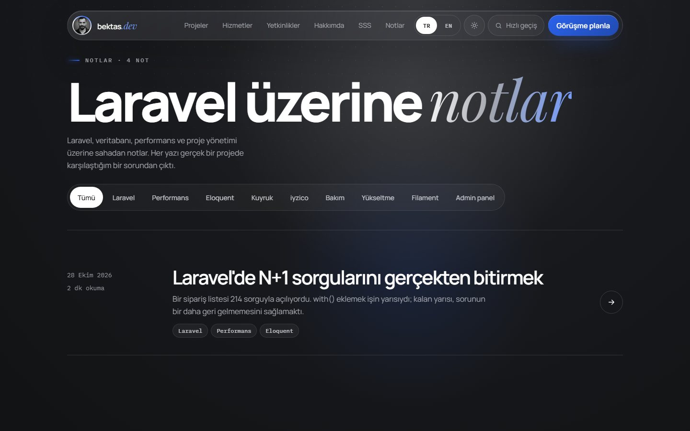
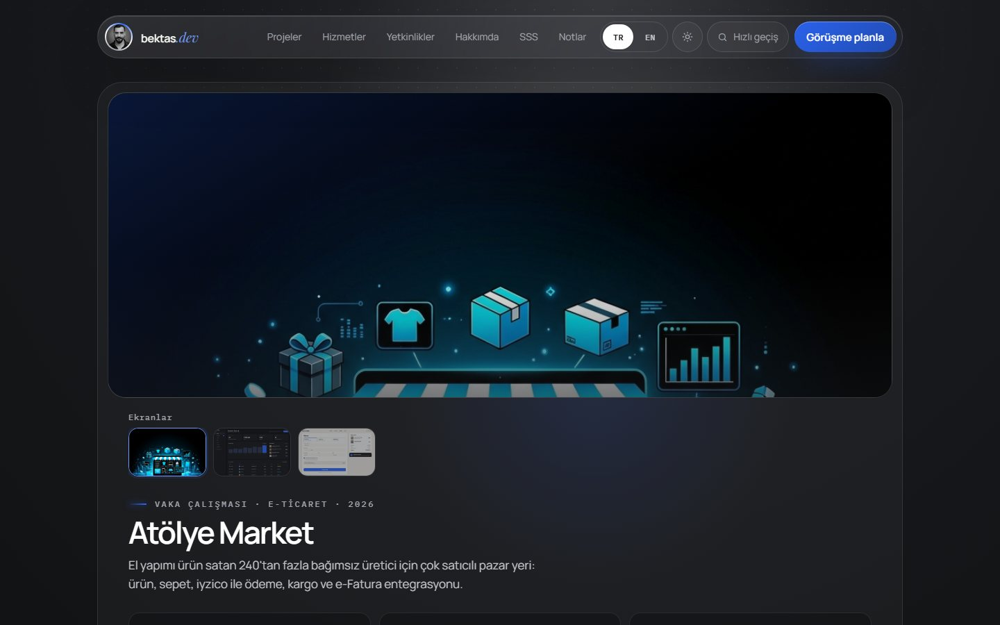
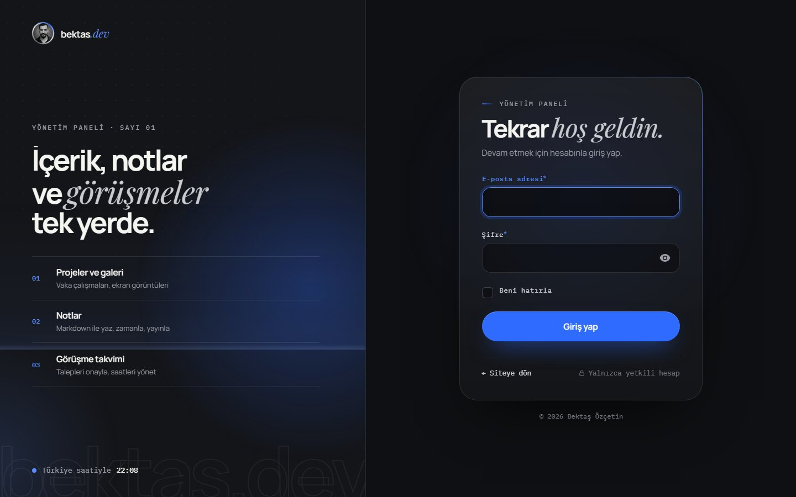

# bektas.dev

Bektaş Özçetin'in kişisel portfolyo sitesi: iki dilli (TR/EN), içeriği tamamen yönetim panelinden düzenlenen, vaka çalışmaları, notlar (blog) ve site içi görüşme takvimi olan bir Laravel uygulaması.

**Laravel 12 · Filament 4 · Tailwind CSS 4 · Alpine.js · SQLite/MySQL · Pest**



| Notlar | Vaka çalışması | Yönetim paneli girişi |
|---|---|---|
|  |  |  |

---

## Özellikler

### Site
- **İki dil, ayrı adresler:** Türkçe `/`, İngilizce `/en`. `hreflang`, canonical ve JSON-LD (Person, BlogPosting) etiketleri hazır.
- **Vaka çalışmaları:** Her proje için sorun, yaklaşım, teknik kararlar ve ölçülebilir sonuç. Açılır pencerede ya da ayrı sayfada (`/projeler/{slug}`) okunur. Ekran görüntüsü galerisi ve "Sonraki proje" geçişi var.
- **Notlar (blog):** `/notlar`, `/en/notes`. Markdown ile yazılır, etikete göre filtrelenir, okuma süresi otomatik hesaplanır. RSS beslemesi: `/feed.xml`.
- **Görüşme takvimi:** "Görüşme planla" butonları site içi takvimi açar. Ziyaretçi gün ve saat seçer, dolu saatler kapalı görünür, talep panele düşer. İstenirse Cal.com/Calendly adresine yönlendirilebilir.
- **İletişim formu:** Sunucu ve tarayıcı doğrulaması, bot tuzağı, hız sınırı (dakikada 3, saatte 10). Mesajlar veritabanına kaydedilir ve e-postayla bildirilir.
- **Paylaşım görselleri:** Ana sayfa, proje ve not sayfaları için 1200×630 Open Graph görselleri GD ile otomatik üretilir.
- **CV indirme:** Türkçe ve İngilizce PDF, panelden yüklenir.
- **Koyu/açık tema**, komut paleti (Ctrl/⌘ + K), kaydırınca beliren animasyonlar, mobil uyum ve erişilebilirlik (klavye, odak yönetimi, `prefers-reduced-motion`).
- **İstatistik:** Proje ve not görüntülenmeleri kişisel veri tutmadan sayılır. İsteğe bağlı olarak Plausible (çerezsiz) ya da Google Analytics 4 (onay bandıyla) bağlanır.

### Yönetim paneli (`/admin`)
- Projeler (galeri dahil), notlar, hizmetler, açık kaynak, deneyim, eğitim, fiyatlar, referanslar, SSS ve markalar.
- Çevrilebilir alanlar Türkçe/English sekmeleriyle düzenlenir; İngilizce boş kalırsa sitede Türkçe gösterilir.
- **Gelen kutusu:** görüşme takvimi (onayla / iptal et) ve iletişim mesajları (okundu takibi, yanıtla).
- **Site ayarları:** CV dosyaları, görüşme günleri ve saatleri, istatistik servisi.
- Ana sayfada özet istatistikler ve en çok bakılan projeler.
- Sitenin tasarımıyla uyumlu, animasyonlu giriş sayfası.

## Kurulum

Gereksinimler: PHP 8.2+ (`intl`, `gd`, `pdo_sqlite` eklentileri açık), Composer, Node 20+.

```bash
git clone https://github.com/bektasozcetin/bektasozcetin.git bektas-dev
cd bektas-dev

composer install
npm install

cp .env.example .env
php artisan key:generate
```

`.env` dosyasında en azından admin hesabını doldur:

```dotenv
ADMIN_EMAIL=sen@ornek.com
ADMIN_PASSWORD=guclu-bir-sifre
```

Veritabanını kur, demo içeriği yükle, dosyaları bağla ve derle:

```bash
touch database/database.sqlite      # Windows: type nul > database\database.sqlite
php artisan migrate --seed
php artisan storage:link
npm run build
php artisan serve
```

Site: <http://127.0.0.1:8000> · Panel: <http://127.0.0.1:8000/admin>

Geliştirirken `npm run dev` ile CSS/JS değişiklikleri anında yansır.

## Ortam değişkenleri

| Değişken | Açıklama |
|---|---|
| `SITE_EMAIL`, `SITE_CITY` | Sitede görünen e-posta ve şehir |
| `SITE_NOTIFY_EMAIL` | Form ve görüşme bildirimlerinin gideceği adres (boşsa `MAIL_FROM_ADDRESS`) |
| `SITE_GITHUB_URL`, `SITE_LINKEDIN_URL`, `SITE_INSTAGRAM_URL` | Sosyal hesaplar (boş olanlar gizlenir) |
| `SITE_REPLY_TIME_TR`, `SITE_REPLY_TIME_EN` | "Genelde ... içinde dönüş yaparım" metni |
| `SITE_AVAILABLE` | Kapaktaki "Yeni projelere açığım" rozeti |
| `SITE_SHOW_SAMPLE_BADGE` | Projelerdeki "örnek veri" etiketi; yayında `false` yap |
| `ADMIN_EMAIL`, `ADMIN_PASSWORD` | Seeder'ın oluşturduğu panel hesabı. Yayında panele yalnızca bu e-posta girebilir. |
| `APP_TIMEZONE` | Varsayılan `Europe/Istanbul`; görüşme saatleri buna göre hesaplanır |
| `MAIL_*` | E-posta gönderimi. Varsayılan `log`: e-postalar `storage/logs/laravel.log` dosyasına yazılır. |

## İçerik nerede?

| İçerik | Nereden düzenlenir |
|---|---|
| Projeler, notlar, hizmetler, deneyim, fiyatlar, referanslar, SSS, markalar | Panel → İçerik |
| Görüşme talepleri ve iletişim mesajları | Panel → Gelen kutusu |
| CV, görüşme takvimi, istatistik servisi | Panel → Ayarlar → Site ayarları |
| E-posta, şehir, sosyal hesaplar | `.env` (`SITE_*`) → `config/site.php` |
| Başlıklar, menü, ilkeler, form metinleri, KVKK metni | `lang/tr/site.php`, `lang/en/site.php` |
| Kod vitrini örnekleri | `config/showcase.php` |

Çevrilebilir alanlar veritabanında `{"tr": "...", "en": "..."}` biçiminde tutulur.

## Proje yapısı

```
app/
  Filament/            Panel kaynakları, Site ayarları sayfası, özel giriş sayfası, panel widget'ları
  Http/Controllers/    Ana sayfa, proje, not, iletişim, görüşme, sitemap, RSS
  Models/              Project, Post, Meeting, Setting, ... (Concerns/HasTranslations)
  Support/             OgImage (paylaşım görselleri), BookingCalendar, CountsViews
database/seeders/      Demo içerik (demo/ klasöründe görseller, galeri ve örnek CV'ler)
lang/{tr,en}/site.php  Sitedeki sabit metinler
resources/
  css/app.css          Tasarım token'ları ve bileşenler (Tailwind 4)
  css/admin-login.css  Panel giriş sayfası
  js/app.js            Alpine bileşenleri: tema, palet, vaka penceresi, form, görüşme takvimi
  fonts/               Paylaşım görselleri için fontlar (Manrope, Playfair Display, IBM Plex Mono)
  views/               Blade şablonları (partials/sections altında ana sayfa bölümleri)
tests/Feature/         Uçtan uca testler
```

## Testler

```bash
php artisan test
```

11 test şunları kontrol eder:
- Herkese açık sayfaların iki dilde açılması
- Yayından kaldırılan projelerin gizlenmesi
- İletişim formu: kayıt, e-posta, doğrulama, bot tuzağı
- Notlar: taslak/zamanlanmış yazıların gizlenmesi, HTML temizleme, RSS
- Galeri, "sonraki proje" ve görüntülenme sayacı (botlar ve tekrarlar sayılmaz)
- CV bağlantıları
- Görüşme takvimi: dolu saat, geçersiz saat, KVKK onayı, bot tuzağı, hız sınırı
- Özel giriş sayfası ve tüm panel sayfaları

## Yayından önce

Demo içerikteki projeler, kişiler, şirketler, notlar, CV ve görüşmeler kurgusaldır.

- [ ] Panelden demo içeriği gerçek projeler, notlar ve referanslarla değiştir.
- [ ] Site ayarları'ndan kendi CV'ni yükle; görüşme gün ve saatlerini ayarla.
- [ ] `.env`: `SITE_*` değerlerini doldur, `SITE_SHOW_SAMPLE_BADGE=false` yap.
- [ ] `lang/*/site.php` içindeki KVKK metnini kontrol et.
- [ ] E-posta için `MAIL_MAILER` ve SMTP ayarlarını gir.
- [ ] `APP_ENV=production`, `APP_DEBUG=false`, `APP_URL=https://alanadin`.
- [ ] Sunucuda: `php artisan migrate --force`, `php artisan storage:link`, `npm run build`, `php artisan optimize`.
